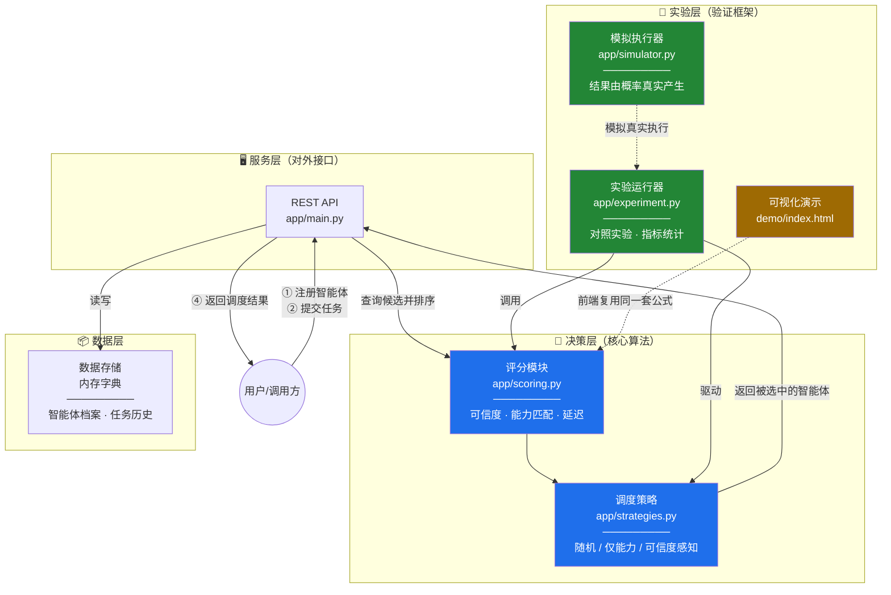
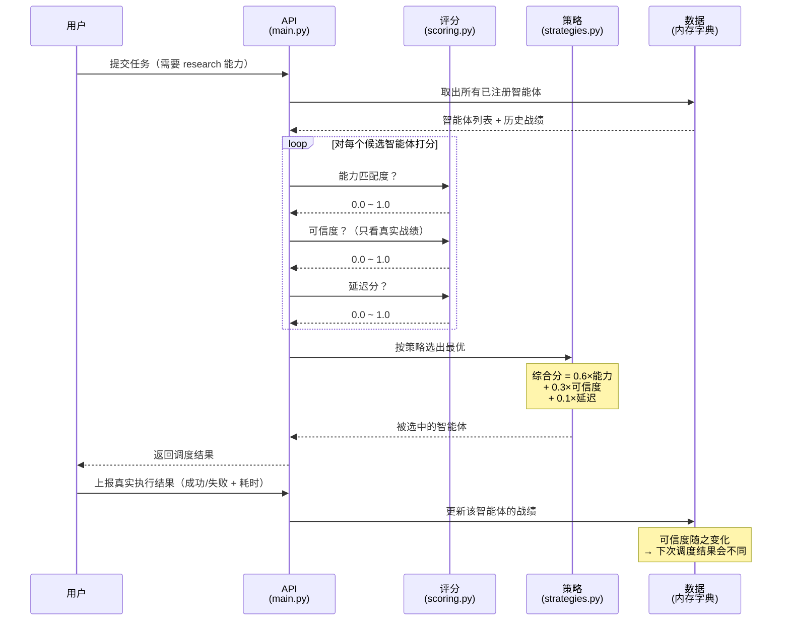
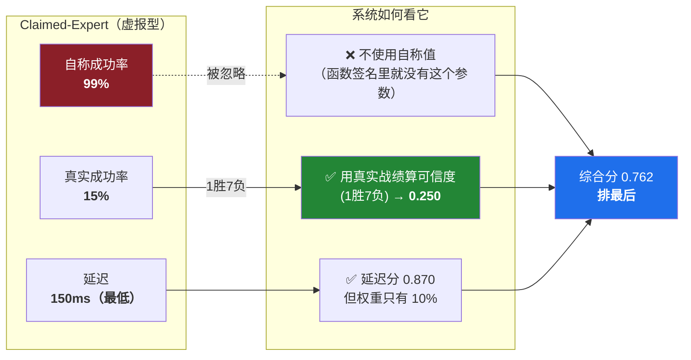
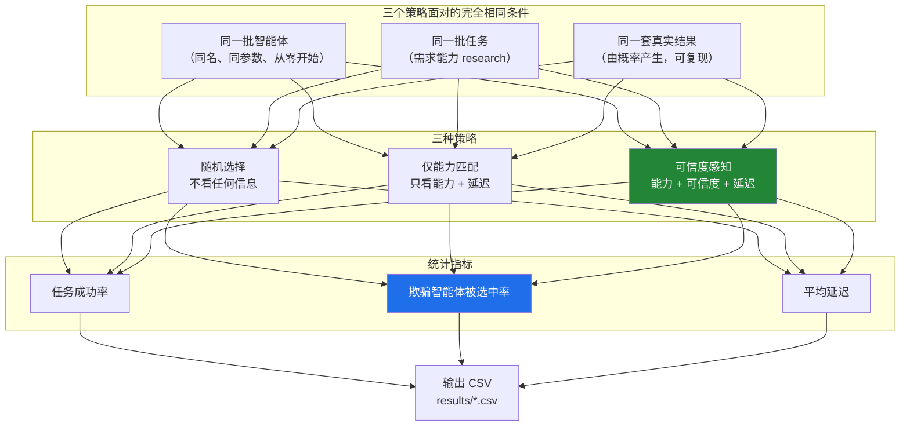
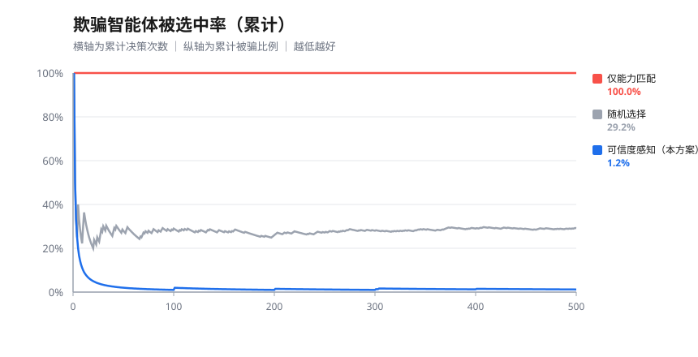

# 系统架构图

本文件包含架构图和相关说明，可直接用于参赛文档和答辩 PPT。

> **看图方式**：下面用 Mermaid 画图，在 GitHub 上能直接看到渲染结果。
> 如果你在 VS Code 里看，需要装 `Markdown Preview Mermaid Support` 插件；
> 或者直接看每个图后面的文字说明，内容是一样的。

---

## 一、整体分层架构



### 文字说明

| 层 | 文件 | 职责 | 说明 |
|---|---|---|---|
| **服务层** | `app/main.py` | 对外提供 REST 接口 | 智能体注册、服务发现、结果记录 |
| **决策层** | `app/scoring.py` | **算分** | 可信度 / 能力匹配 / 延迟三项加权 |
| | `app/strategies.py` | **选人** | 三种策略，可对比 |
| **数据层** | 内存字典 | 存数据 | 重启会清空（SQLite 为后续可选项） |
| **实验层** | `app/simulator.py` | 模拟真实执行 | 结果由概率产生，不是写死的 |
| | `app/experiment.py` | 跑对照实验 | 统计指标，输出 CSV |
| | `demo/index.html` | 可视化演示 | 前端复用同一套公式 |

> **关键设计**：决策层（`scoring.py` + `strategies.py`）是纯逻辑，不依赖网络和存储。
> 所以它既能被服务层调用，也能被实验层调用，还能被前端复用 —— **一处定义，三处复用**。

---

## 二、核心调度闭环



### 这个闭环的关键

**第 8 步"上报真实结果"是整个系统的灵魂。**

没有这一步，系统永远不知道谁在撒谎，只能相信自我声明。
有了这一步，**可信度会随着真实表现自动修正** —— 这就是"学习"发生的地方。

---

## 三、抗欺骗机制的原理



### 为什么这个设计能抗欺骗

| 防线 | 做法 | 效果 |
|---|---|---|
| **第一道** | `trust_score()` 的**参数列表里没有"宣称成功率"** | 从代码结构上杜绝被影响 |
| **第二道** | 可信度只由**真实战绩**计算 | 骗子 1 胜 7 负 → 0.250 |
| **第三道** | 每次任务后**更新战绩** | 骗子越骗，分数越低 |
| **第四道** | 延迟权重仅 10% | 骗子"延迟最低"的优势不足以翻盘 |

---

## 四、对照实验设计



### 实验规模

```
5 次独立试验 × 100 轮 × 3 种策略 = 1500 次调度决策
固定随机种子 42，完全可复现
```

---

## 五、实验结果


### 数据表

```
策略              任务成功率    欺骗被选中率
─────────────────────────────────────────
仅能力匹配         16.20%       100.00%
随机选择           58.40%        29.20%
可信度感知         78.40%         1.20%   ← 本方案
```

### 被骗率随决策次数的变化



**读图要点**：

- **红线（仅能力匹配）一直贴在 100%** —— 它从头到尾都在选骗子，一次都没纠正
- **灰线（随机选择）稳定在 29% 左右** —— 三个智能体里一个骗子，随机命中率约 1/3，符合预期
- **蓝线（本方案）在头几十次决策内陡降到接近 0**，之后一直保持
  —— **这就是"系统学会了"的可视化证据**

> 图表由 `调研/生成图表.py` 从 `results/*_rounds.csv` **原始数据自动生成**，
> 重跑实验后会更新。不是手工画的，数字可追溯到原始记录。

### 三个核心发现

| # | 发现 | 说明 |
|---|---|---|
| 1 | **"仅能力匹配"比随机还差 4 倍** | 能力项恒为 1.0 失去区分作用 → 退化为"只看延迟" → 骗子延迟最低 → 500 轮里被选 500 次 |
| 2 | **可信度感知把被骗率压到 1.20%** | 20 轮之后降为 **0.00%**，系统确实学会了识别虚报型 |
| 3 | **冷启动阶段所有策略都会先被骗** | 第 1 轮三家可信度都是先验值 0.5，并列时按延迟决胜 → 必然选中骗子 |

---

## 六、已知局限

> **这一节必须写进参赛文档，也必须能口头讲清楚。**


| # | 局限 | 实测证据 |
|---|---|---|
| 1 | **冷启动会被骗** | 第 1 轮必然选中 Claimed-Expert（并列时按延迟决胜） |
| 2 | **过早锁定（最严重）** | 第 2 轮一次随机成败 → 该智能体此后被选 97~99 次 |
| 3 | **从不探索，智能体利用率极低** | 5 次试验中有 **1 次** `Reliable-Researcher` 被选中 **0 次**；其余试验也都是"一个智能体包揽 97~99 次" |
| 4 | **延迟维度形同虚设** | 受上一条影响，权重 10% 的延迟几乎不起作用 |
| 5 | 实验设计不完整 | 任务只要求单项能力，**无法体现"能力匹配"项的作用** |
| 6 | 权重是经验值 | 60/30/10 未做敏感性实验 |
| 7 | 参数是设定的演示值 | 成功率与延迟非真实系统测量数据 |

### 各试验的实际选择分布（原始数据可核对）

| 试验 | Claimed-Expert | Fast-Generalist | Reliable-Researcher |
|---|---|---|---|
| trial 0 | 1 | 1 | **98** |
| trial 1 | 1 | **99** | **0** |
| trial 2 | 1 | 1 | **98** |
| trial 3 | 2 | **97** | 1 |
| trial 4 | 1 | 1 | **98** |

**每个试验都是"一边倒"，但倒向谁完全取决于第 2 轮那一次随机成败。**

### 已做的探索

我们测试了引入 **UCB 探索机制**（多臂老虎机标准算法）的效果：

| 指标 | 原方案 | UCB 探索版 |
|---|---|---|
| 任务成功率 平均 | **77.29%** | 75.00% |
| 任务成功率 最差 | 72.00% | **73.00%** |
| 任务成功率 标准差 | 3.29% | **1.60%** |
| 欺骗被选中率 | **1.25%** | 6.58% |

**结论**：UCB **没有提高平均成功率**，但把标准差**降低了一半**，
最坏情况也有所改善。这说明探索机制的价值在于**降低对运气的依赖**，而非提高平均值。

> 这个"没有变好"的结论我们如实保留 —— 它揭示了"过早锁定"并非纯粹的缺陷，
> 而是**探索与利用（exploration vs exploitation）的取舍**。

---

## 七、怎么用这些图

| 用途 | 用哪张图 |
|---|---|
| 答辩开场，讲系统全貌 | 第一张「整体分层架构」 |
| 讲核心机制 | 第二张「核心调度闭环」 |
| 讲创新点 | 第三张「抗欺骗机制原理」 |
| 讲实验方法 | 第四张「对照实验设计」 |
| **主动讲局限** | 第六节的表格 |
