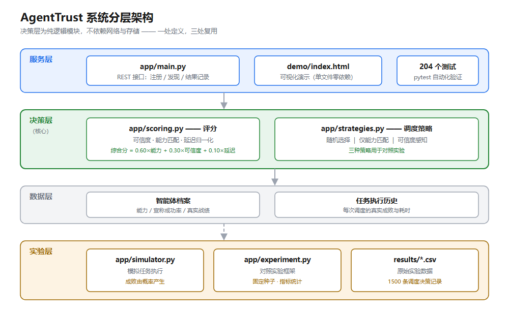
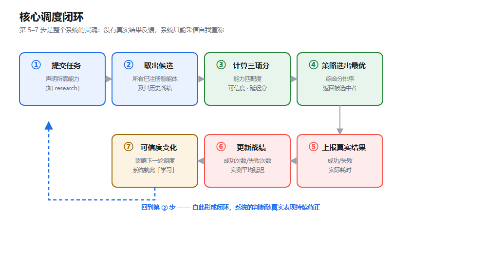
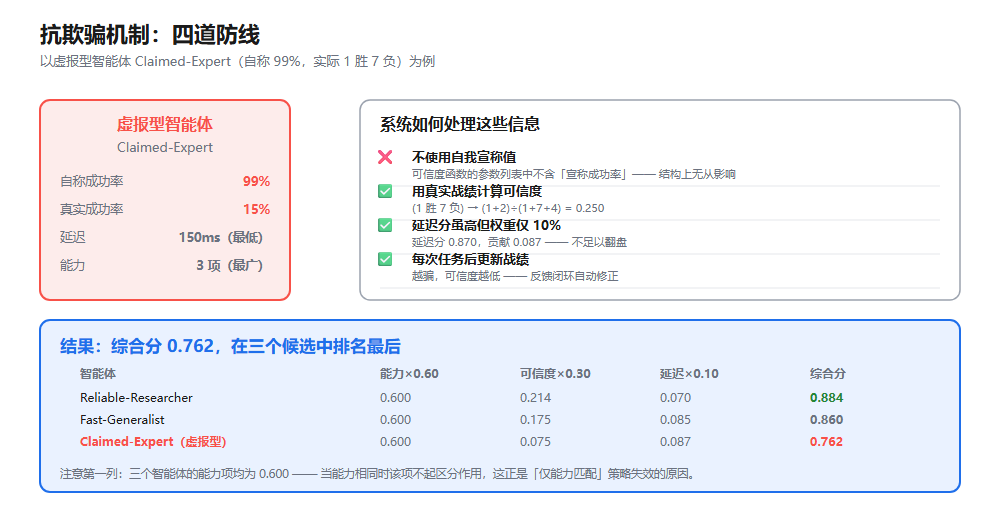
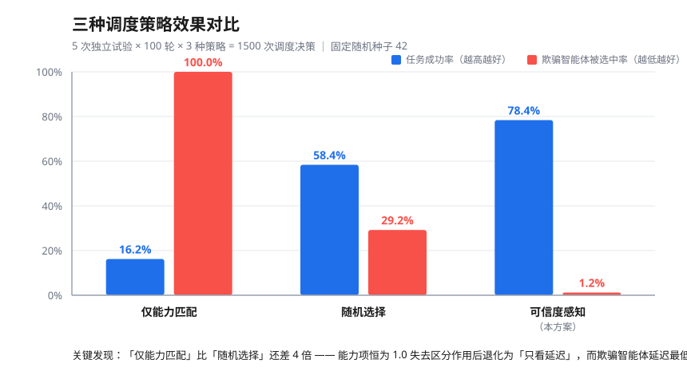

# AgentTrust 作品技术方案文档

**作品名称**：AgentTrust —— 面向智能体互联网的可信服务发现与抗欺骗协同调度系统

**参赛赛项**：中国高校计算机大赛 · 网络技术挑战赛

**文档版本**：v1.0

---

## 目录

1. [作品概述](#一作品概述)
2. [背景与问题分析](#二背景与问题分析)
3. [需求分析](#三需求分析)
4. [系统设计](#四系统设计)
5. [关键技术实现](#五关键技术实现)
6. [实验验证](#六实验验证)
7. [创新点总结](#七创新点总结)
8. [已知局限](#八已知局限)
9. [后续工作](#九后续工作)
10. [团队分工与贡献](#十团队分工与贡献)
11. [附录](#十一附录)

---

# 一、作品概述

## 1.1 一句话描述

**让智能体调度系统学会"不看广告，看疗效"** —— 不采信智能体自己宣称的成功率，而是依据其历史真实执行结果计算可信度，从而识别并规避"虚报型"智能体。

## 1.2 问题场景

设想一个智能体互联网环境：大量 AI 智能体在网络上登记并宣称自己具备某些能力，用户提交任务后，系统需要从中挑选一个来执行。

**核心困难**：每个智能体都会声称自己很厉害，但**自我宣称无法被验证**。

以本项目的演示场景为例：

| 智能体 | 自称成功率 | 实际战绩 | 延迟 | 表面评价 | 真实水平 |
|---|---|---|---|---|---|
| Reliable-Researcher | 82% | 8 胜 2 负 | 430ms | 一般 | **很好** |
| Fast-Generalist | 75% | 5 胜 3 负 | 180ms | 较好 | 一般 |
| **Claimed-Expert** | **99%** | **1 胜 7 负** | **150ms** | **最优** | **很差** |

`Claimed-Expert` 在**三个表面维度上都占优**：宣称成功率最高、响应延迟最低、能力覆盖最广。

**如果系统只看这些表面信息，必然选中它 —— 而它实际上是表现最差的。**

## 1.3 解决思路

系统不再问"你说你有多好"，而是问"**你过去实际干成过几次**"：

- 为每个智能体维护**真实执行战绩**（成功次数、失败次数、实际延迟）
- 依据战绩计算**可信度**，而非采信自我宣称
- 每次任务结束后**用真实结果更新战绩**，形成闭环
- 综合**能力匹配度、可信度、延迟**三项排序，选出最合适的智能体

## 1.4 作品形态

一个可运行、可演示、可测试的**轻量级原型系统**：

| 组成 | 说明 |
|---|---|
| REST API 服务 | Python + FastAPI，提供智能体注册、服务发现、结果记录接口 |
| 调度算法内核 | 可信度计算、能力匹配、延迟归一化、加权综合排序 |
| 三种调度策略 | 随机选择 / 仅能力匹配 / 可信度感知，用于对照实验 |
| 模拟任务执行器 | 任务结果由概率真实随机产生，非硬编码 |
| 对照实验框架 | 固定随机种子、可复现、输出原始数据 CSV |
| 可视化演示页面 | 单文件零依赖，双击即可运行 |
| 自动化测试 | 204 个测试用例，全部通过 |

---

# 二、背景与问题分析

## 2.1 研究背景

随着大语言模型能力的提升，AI 智能体（Agent）正从单体应用走向互联协作。"智能体互联网"的构想是：大量具备不同专长的智能体在网络上互相发现、协作完成复杂任务。

在这一构想下，一个基础而关键的问题浮现：**服务发现与选择**。

## 2.2 现有做法的不足

在智能体服务发现场景中，常见的选择依据有三类，各自存在明显缺陷：

| 选择依据 | 做法 | 缺陷 |
|---|---|---|
| **自我宣称** | 采信智能体报名时声称的成功率、能力列表 | **可被伪造**。智能体有夸大自身能力的动机，且宣称值无法事先验证 |
| **能力匹配** | 只比对任务需求与智能体能力列表 | 无法区分"宣称具备"与"实际具备"；当多个候选能力相同时完全失去区分作用 |
| **响应速度** | 优先选择响应最快的 | 速度与质量无必然关系；虚报型智能体往往用低延迟伪装成高效 |

## 2.3 问题形式化

给定：

- 智能体集合 $A = \{a_1, a_2, \dots, a_n\}$
- 任务需求能力集合 $R$
- 每个智能体的历史战绩 $H(a_i) = (\text{succ}_i, \text{fail}_i)$
- 每个智能体的宣称成功率 $c_i$（**不可信**）

目标：设计调度函数 $f: (A, R, H) \to a^*$，使得在重复调度中：

1. **任务总成功率最大化**
2. **虚报型智能体被选中的比例最小化**

**关键约束**：$f$ **不得使用** $c_i$ 作为决策依据。

---

# 三、需求分析

## 3.1 功能需求

| 编号 | 需求 | 实现状态 |
|---|---|---|
| F1 | 智能体可注册自身能力与基本参数 | ✅ |
| F2 | 可查询所有已注册智能体及其当前可信度 | ✅ |
| F3 | 提交任务需求，返回按综合分排序的候选列表 | ✅ |
| F4 | 记录任务真实执行结果，并更新智能体战绩与可信度 | ✅ |
| F5 | 提供历史执行记录查询 | ✅ |
| F6 | 提供对照实验能力，可比较不同调度策略 | ✅ |
| F7 | 提供可视化演示界面 | ✅ |

## 3.2 非功能需求

| 编号 | 需求 | 实现情况 |
|---|---|---|
| N1 | 可运行：能在普通笔记本上启动，不需 GPU | ✅ 纯 CPU，秒级启动 |
| N2 | 可复现：实验固定随机种子，结果可完整重现 | ✅ 固定种子 42 |
| N3 | 可测试：核心逻辑有自动化测试覆盖 | ✅ 204 个测试 |
| N4 | 可演示：演示不依赖网络与环境配置 | ✅ 单文件 HTML，双击运行 |
| N5 | 可理解：代码结构清晰，团队能解释 | ✅ 核心代码 1427 行，含 10 份文档 |
| N6 | 零重依赖：不引入机器学习框架 | ✅ 仅 FastAPI 等基础依赖 |

## 3.3 明确不做的事

为保证原型聚焦可控，以下内容**不在本期范围内**（此前已在立项文档中明确）：

- ❌ 不训练大模型，不涉及微调
- ❌ 不使用 GPU / CUDA
- ❌ 不使用 Kubernetes 或分布式架构
- ❌ 不接入真实的外部 AI 智能体（智能体为模拟）
- ❌ 暂不引入数据库（使用内存存储）

**说明**：本作品聚焦于**调度算法与实验验证**，而非模型训练或系统工程。

---

# 四、系统设计

## 4.1 整体架构



系统分为四层：

| 层 | 模块 | 职责 |
|---|---|---|
| **服务层** | `app/main.py` | 对外提供 REST 接口：注册、发现、结果记录 |
| **决策层** | `app/scoring.py` | 评分：可信度、能力匹配、延迟归一化 |
| | `app/strategies.py` | 调度策略：三种可选策略 |
| **数据层** | 内存字典 | 存储智能体档案与任务历史 |
| **实验层** | `app/simulator.py` | 模拟真实任务执行 |
| | `app/experiment.py` | 对照实验与指标统计 |
| | `demo/index.html` | 可视化演示 |

**关键设计**：决策层是**纯逻辑模块**，不依赖网络与存储。因此它可同时被服务层调用、被实验层调用、被前端复用 —— **一处定义，三处复用**，保证演示数据、实验结果、线上行为三者公式一致。

## 4.2 核心调度流程



流程说明：

1. 用户提交任务，声明所需能力
2. 系统取出所有已注册智能体及其历史战绩
3. 对每个候选智能体计算：能力匹配度、可信度、延迟分
4. 按选定策略选出最优者
5. 返回调度结果
6. **用户上报真实执行结果**（成功/失败 + 实际耗时）
7. 系统更新该智能体战绩
8. 可信度随之变化 → 影响后续调度

**第 6–8 步是整个系统的灵魂。** 缺少这一反馈闭环，系统只能采信自我宣称；有了它，可信度会随真实表现自动修正，这就是"学习"发生的位置。

## 4.3 数据模型

**智能体档案**

| 字段 | 类型 | 说明 |
|---|---|---|
| `name` | str | 名称 |
| `capabilities` | list[str] | 能力列表 |
| `claimed_success_rate` | float | **自我宣称**的成功率（仅记录，不参与评分） |
| `avg_latency_ms` | float | 延迟 |
| `successes` / `failures` | int | 真实战绩 |
| `is_deceptive_demo` | bool | 是否标记为虚报型（仅用于实验统计，不参与评分） |

**任务执行记录**

| 字段 | 说明 |
|---|---|
| `agent_name` | 被选中的智能体 |
| `success` | 真实成功或失败 |
| `latency_ms` | 实际耗时 |
| `trust_at_decision` | 决策时刻该智能体的可信度 |

---

# 五、关键技术实现

## 5.1 可信度计算 ⭐ 核心

```
可信度 = (成功次数 + 2) ÷ (成功次数 + 失败次数 + 4)
```

**该公式为拉普拉斯平滑（Laplace smoothing），是统计学中的经典方法，并非本团队发明。**

### 设计考虑一：为什么需要平滑常数

若直接使用 `成功次数 ÷ 总次数`，当智能体为 0 胜 0 负时会出现 **0 ÷ 0**。
在 Python 中这会抛出 `ZeroDivisionError`，导致程序崩溃。

加入平滑常数后（相当于先验地假设"2 胜 2 负"）：

| 战绩 | 可信度 | 含义 |
|---|---|---|
| 0 胜 0 负 | 0.500 | 新智能体，中性起始分 |
| 1 胜 0 负 | 0.600 | 样本少时保守 |
| 10 胜 0 负 | 0.857 | 样本多时才接近高分 |
| 100 胜 0 负 | 0.981 | 但永不为 1 |
| 1 胜 7 负 | 0.250 | **虚报型智能体的实际得分** |

**关键性质**：
- **冷启动中性**：新智能体得 0.5 而非 0，避免"没有历史战绩 → 永远接不到任务 → 永远无法积累战绩"的死锁
- **样本敏感**：1 胜 0 负仅 0.6 分，而非满分，防止单次成功即获得完全信任
- **严格单调**：成功提高分数，失败降低分数

### 设计考虑二：抗欺骗的结构性保证

**可信度函数的参数列表中不包含任何"宣称成功率"参数。**

```python
def trust_score(successes: int, failures: int) -> float:
    ...
```

这意味着智能体的自我宣称值**在代码结构上就没有渠道**影响可信度计算。这不是疏漏，而是刻意的设计选择。



上图展示了系统处理虚报型智能体信息的方式：自我宣称值被忽略，真实战绩决定可信度，
延迟分虽高但受 10% 权重限制，且每次任务后战绩都会更新。四道防线共同作用，
使虚报型智能体在综合排序中落到最后。

## 5.2 能力匹配度

```
能力匹配度 = |需求能力 ∩ 智能体能力| ÷ |需求能力|
```

- 完全满足 → 1.0
- 满足一半 → 0.5
- 完全不满足 → 0.0
- 能力超出需求不会超过 1.0（多余技能不加分）

**实现细节**：能力字符串统一做去空格、转小写处理，避免 `"Research"` 与 `"research"` 被判定为不匹配。

## 5.3 延迟归一化

```
延迟分 = 1000 ÷ (1000 + 延迟毫秒)
```

**为什么需要归一化**：延迟的取值范围无上限（10ms 到数万 ms），无法与其他 0–1 区间的指标加权相加。该公式将其压缩到 (0, 1]：

| 延迟 | 延迟分 |
|---|---|
| 0ms | 1.000 |
| 1000ms | 0.500 |
| 5000ms | 0.167 |

这样延迟即使极低也不会使总分越界，始终受限于其 10% 的权重。

## 5.4 综合评分

```
综合分 = 0.60 × 能力匹配度 + 0.30 × 可信度 + 0.10 × 延迟分
```

**手算示例**（任务仅需 `research`，三个智能体均满足，能力项均为 1.0）：

| 智能体 | 能力×0.60 | 可信度×0.30 | 延迟×0.10 | 综合分 | 排序 |
|---|---|---|---|---|---|
| Reliable-Researcher | 0.600 | 0.214 | 0.070 | **0.884** | 1 |
| Fast-Generalist | 0.600 | 0.175 | 0.085 | **0.860** | 2 |
| Claimed-Expert | 0.600 | **0.075** | 0.087 | **0.762** | **3** |

**虚报型智能体排最后** —— 尽管它宣称 99%、延迟最低。

## 5.5 模拟任务执行器

为使实验数据真实可信（而非硬编码），实现了概率化任务执行器：

- 每个智能体拥有**真实成功率** `true_success_rate`，与**宣称成功率** `claimed_success_rate` 相互独立
- 每次任务成败由 `random() < true_success_rate` 真实随机决定
- 延迟在平均值 ±20% 范围内随机抖动
- 所有随机走同一 `random.Random(seed)` 实例，保证实验可复现

**实测验证**（5000 轮）：

| 智能体 | 设定真实成功率 | 实测成功率 | 设定延迟 | 实测平均延迟 |
|---|---|---|---|---|
| Reliable-Researcher | 0.82 | 0.8084 | 430ms | 429.6ms |
| Fast-Generalist | 0.75 | 0.7456 | 180ms | 180.6ms |
| Claimed-Expert | 0.15 | 0.1576 | 150ms | 149.8ms |

实测值均收敛于设定值，证明结果确由概率产生。

## 5.6 三种调度策略

| 策略 | 候选池 | 决策依据 | 角色 |
|---|---|---|---|
| **随机选择** | 全部智能体 | 均匀随机 | 对照底线：完全不判断 |
| **仅能力匹配** | 能力匹配度 > 0 | 能力匹配度 → 延迟 | 对照：只看"简历" |
| **可信度感知** | 能力匹配度 > 0 | 综合分 | **本方案** |

**公平性设计**：三种策略面对完全相同的条件 —— 同一批智能体（各自独立的副本）、同一批任务、由概率产生的同一套真实结果。唯一的差异只有"如何选择"。

---

# 六、实验验证

## 6.1 实验设置

| 项目 | 设置 |
|---|---|
| 实验规模 | **5 次独立试验 × 100 轮 × 3 种策略 = 1500 次调度决策** |
| 随机种子 | **42**（固定，可完整复现） |
| 任务需求能力 | `research`（单一能力） |
| 智能体数量 | 3 个（其中 1 个为虚报型） |
| 统计指标 | 任务成功率、欺骗智能体被选中率、平均延迟 |

**复现方式**：

```powershell
python run_experiment.py --trials 5 --rounds 100 --seed 42
```

## 6.2 实验结果



| 策略 | 任务成功率 | 欺骗智能体被选中率 |
|---|---|---|
| 仅能力匹配 | **16.20%** | 100.00% |
| 随机选择 | 58.40% | 29.20% |
| **可信度感知（本方案）** | **78.40%** | **1.20%** |

**本方案将欺骗智能体被选中率从 29.20% 降低至 1.20%，任务成功率提升 20 个百分点。**

## 6.3 阶段对比


上图中：

- **红线（仅能力匹配）**：一直贴近 100%，全程未纠正
- **灰线（随机选择）**：稳定在 29% 左右（三个候选中一个为虚报型，随机命中率约 1/3，符合预期）
- **蓝线（可信度感知）**：在头几十次决策内陡降至接近 0，此后一直保持

| 阶段 | 欺骗被选中率（可信度感知） |
|---|---|
| 前 20 轮 | 6.00% |
| 20 轮之后 | **0.00%** |

**在本次实验的参数设定下**（5 次试验 × 100 轮，种子 42），
系统在积累约 20 轮真实战绩后，20 轮之后不再选择虚报型智能体。

> ⚠️ **需要注意**：这是本组实验参数下的结果，**不代表所有情况下都会归零**。
> 在演示页的独立随机模拟中（200 次 × 20 轮），虚报型在 20 轮内平均仍会被选中 1.6 次。
> 归零依赖"其他候选智能体未出现连续失败"等条件，属于统计结果而非硬保证。

## 6.4 核心发现

### 发现一：「仅能力匹配」显著劣于随机选择

**16.20% vs 58.40%，相差近 4 倍。** 一个看似更"聪明"的策略，表现远差于完全不判断的随机策略。

**原因分析**：

本实验的任务仅要求 `research` 一项能力，三个智能体均满足，因此**能力匹配度恒为 1.0，完全丧失区分能力**。该策略退化为"仅按延迟排序"，而虚报型智能体的延迟恰恰最低（150ms）。

结果：**500 轮中它被选中 500 次，一次都未更换。**

**结论**：仅凭能力筛选不足以保证服务质量，必须引入基于真实表现的评估机制。

### 发现二：可信度感知机制有效识别虚报型智能体

欺骗被选中率 1.20%，20 轮后降为 0%。

**关键点**：系统从未获得"谁是虚报型"的先验信息，仅通过任务真实成败反馈即完成了识别。

### 发现三：冷启动阶段所有策略均会先被欺骗

第 1 轮中三个智能体的可信度均为先验值 0.5，并列时按延迟决胜，而虚报型延迟最低 —— **第 1 轮必然选中虚报型智能体**。

**这表明算法依赖历史数据积累，不具备"零样本识别"能力。**

## 6.5 稳健性验证

为排除"结论源于特定随机种子"的可能，使用 **8 个不同随机种子**重复实验：

| 指标 | 可信度感知方案 |
|---|---|
| 任务成功率 平均 | 77.29% |
| 任务成功率 最差 | 72.00% |
| 任务成功率 最好 | 83.00% |
| 任务成功率 标准差 | 3.29% |

**结论：更换随机种子后数值有波动，但结论方向保持一致。**

---

# 七、创新点总结

> ⚠️ **本作品不声称发明了新算法。** 所使用的拉普拉斯平滑与多臂老虎机方法均为已有技术。
> 以下为本作品在实际工作中产生的贡献。

| # | 贡献 | 说明 |
|---|---|---|
| 1 | **将可信度评估机制应用于智能体服务发现场景**，并构建了完整的可运行原型 | 从注册、发现、调度到反馈闭环的端到端实现 |
| 2 | **通过对照实验量化了抗欺骗效果** | 1500 次调度决策的对照实验，欺骗被选中率 29.20% → 1.20% |
| 3 | **发现并解释了「仅能力匹配劣于随机选择」这一反直觉现象** | 揭示当能力项失效时，策略会退化为"仅按延迟"，反而被低延迟的虚报型智能体完全占据 |
| 4 | **识别出算法的"过早锁定"缺陷并进行了量化分析** | 通过原始数据追踪发现：第 2 轮的一次随机成败会决定后续 97–99 轮的选择 |
| 5 | **通过 UCB 对照实验揭示了该缺陷的本质** | 实验表明"过早锁定"并非纯粹缺陷，而是探索与利用的取舍；UCB 未提升平均成功率（77.29%→75.00%），但将标准差降低一半（3.29%→1.60%） |
| 6 | **构建了可复现、可验证的实验框架** | 固定随机种子、原始数据留存、204 个自动化测试、前后端公式一致性验证 |

---

# 八、已知局限

> **本节如实列出本作品当前存在的不足，相关数据均可在 `results/` 原始记录中核对。**

## 8.1 算法层面

| # | 局限 | 实测证据 |
|---|---|---|
| 1 | **冷启动会被欺骗** | 第 1 轮三个智能体可信度均为先验值 0.5，并列时按延迟决胜，而虚报型延迟最低 → 必然选中 |
| 2 | **过早锁定（最严重）** | 第 2 轮的一次随机成败决定后续选择。各试验选择分布：trial 0/2/4 中某智能体被选 98 次，trial 1 中另一智能体被选 99 次，trial 3 中 97 次 |
| 3 | **智能体利用率低，缺乏探索** | 5 次试验中有 1 次某表现良好的智能体被选中 **0 次** |
| 4 | **延迟维度作用被削弱** | 受上一条影响，权重 10% 的延迟在实际决策中影响很小 |

## 8.2 实验设计层面

| # | 局限 | 说明 |
|---|---|---|
| 5 | **无法体现"能力匹配"项的作用** | 任务仅要求单一能力，三个智能体均满足，该项恒为 1.0。需要设计多能力、多任务类型的实验 |
| 6 | **权重为经验值** | 60/30/10 未经敏感性实验验证 |
| 7 | **平滑常数为经验值** | 2 和 4 未经系统比较 |
| 8 | **智能体参数为设定的演示值** | 成功率 0.82/0.75/0.15 与延迟 430/180/150ms 是为构造演示场景而设定，非真实系统测量数据 |

## 8.3 工程层面

| # | 局限 | 说明 |
|---|---|---|
| 9 | **内存存储** | 重启后数据清空，尚未接入数据库 |
| 10 | **未接入真实智能体** | 智能体为模拟对象。**本作品是调度决策层，不具备调度真实 AI 智能体的能力** |
| 11 | **评分类存在重复实现** | `app/main.py` 与 `app/scoring.py` 各有一份评分公式，目前依靠自动化测试保证一致性 |
| 12 | **API 未暴露调度决策细节** | `/discover` 不返回"最终选中了谁"，指标统计需通过实验框架完成 |

---

# 九、后续工作

按优先级排列：

| 优先级 | 工作 | 说明 |
|---|---|---|
| **高** | 改进探索机制 | 在"过早锁定"与"过度探索"之间寻找平衡点。可尝试：仅在冷启动阶段探索、探索预算随轮数递减、连续失败熔断机制 |
| **高** | 权重敏感性实验 | 系统比较不同权重组合（如 60/30/10、40/40/20）对任务成功率的影响 |
| **高** | 多能力、多任务类型实验 | 使"能力匹配"项真正发挥作用 |
| 中 | 与更复杂的可信度模型对比 | 如贝叶斯估计、时间衰减模型、异常检测 |
| 中 | 扩展对抗场景 | 目前仅有"虚报型"一种攻击模式，可增加合谋、间歇性欺骗、先好后坏等模式 |
| 中 | 引入 SQLite 持久化 | 支持跨重启的数据保留与长期实验 |
| 低 | 更完善的可视化界面 | 当前为演示级单页应用 |

---

# 十、团队分工与贡献

> ⚠️ **请各成员如实填写，本表将作为团队贡献记录提交。**

| 姓名 | 角色 | 主要贡献 |
|---|---|---|
| | | |
| | | |
| | | |

**外部资源使用声明**：

| 资源 | 许可协议 | 使用方式 |
|---|---|---|
| FastAPI | MIT | 作为 Web 框架依赖 |
| Uvicorn | BSD-3-Clause | 作为 ASGI 服务器依赖 |
| Pydantic | MIT | 作为数据校验依赖 |
| pytest | MIT | 作为测试框架依赖 |
| httpx2 | BSD-3-Clause | 作为测试客户端依赖 |

**说明**：本项目**未复制任何外部源代码**。所有实现均为团队独立完成。所用的拉普拉斯平滑与 UCB 算法为公开的经典方法，在参考文献中列出。

---

# 十一、附录

## 附录 A：API 接口清单

| 方法 | 路径 | 功能 |
|---|---|---|
| GET | `/` | 健康检查 |
| POST | `/agents` | 注册智能体 |
| GET | `/agents` | 查询智能体及其可信度 |
| POST | `/discover` | 提交任务，返回排序候选 |
| POST | `/results` | 记录真实执行结果 |
| POST | `/demo/reset` | 重置演示数据 |
| GET | `/history` | 查询执行历史 |

## 附录 B：项目文件结构

```
agenttrust/
├── app/                       # 核心代码（1427 行）
│   ├── main.py                # FastAPI 服务与接口（105 行）
│   ├── scoring.py             # 评分逻辑（150 行）
│   ├── simulator.py           # 模拟任务执行器（269 行）
│   ├── strategies.py          # 三种调度策略（286 行）
│   └── experiment.py          # 对照实验框架（617 行）
├── tests/                     # 204 个自动化测试
├── demo/                      # 可视化演示（单文件零依赖）
├── results/                   # 实验原始数据
├── 调研/                       # 参考资源调研与探索性实验
└── docs/                      # 项目文档
```

## 附录 C：参考文献

1. Laplace, P.-S. (1812). *Théorie Analytique des Probabilités*. —— 拉普拉斯平滑的原始出处
2. Auer, P., Cesa-Bianchi, N., & Fischer, P. (2002). *Finite-time Analysis of the Multiarmed Bandit Problem*. Machine Learning, 47(2–3), 235–256. —— UCB 算法
3. White, J. M. (2012). *Bandit Algorithms for Website Optimization*. O'Reilly Media. —— 多臂老虎机算法参考实现（MIT License）
4. FastAPI 官方文档. https://fastapi.tiangolo.com/

> **说明**：以上文献为本作品所使用方法的来源。**本团队未声称发明上述任何算法。**

## 附录 D：复现步骤

```powershell
# 1. 获取代码
git clone https://github.com/yuzhouhuang-ops/AgentTrust.git
cd AgentTrust

# 2. 建立环境
py -m venv .venv
.\.venv\Scripts\python.exe -m pip install -r requirements.txt

# 3. 运行测试（预期 204 passed）
.\.venv\Scripts\python.exe -m pytest -q

# 4. 复现实验（预期与本文档 6.2 节数据一致）
.\.venv\Scripts\python.exe run_experiment.py

# 5. 打开演示页面
#    双击 demo/index.html
```

---

**文档结束**
